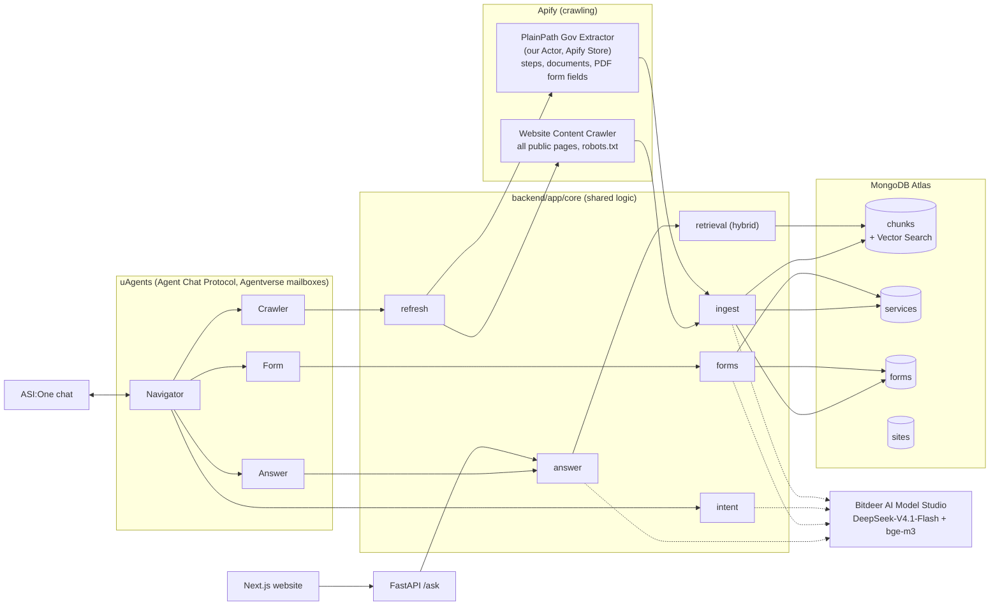

# PlainPath

**Government websites, in plain words, in your language.**

PlainPath helps blind and low-vision users, older adults, and people with limited English get things done on
official government websites. Say what you need in any language, for example *"I want to renew my disabled parking
placard in Contra Costa. I only speak Chinese."* PlainPath finds the answer in the **official website, crawled with
Apify** (including PDF forms), and replies with short numbered steps, the documents to bring, and plain explanations
of the official forms. **Every step links to the official page and shows the date it was crawled.** If the official
website does not cover the question, PlainPath says so and links the agency's contact page; it never answers from
memory.

Two entry points share one backend and one set of agents:

1. **ASI:One chat (Fetch.ai)**: four uAgents (Navigator, Crawler, Answer, Form) speak the Agent Chat Protocol and
   use ASI Interactive Cards (form, step carousel, checklist), so the whole flow happens inside the ASI:One chat.
2. **Accessible website**: one question box, voice input, large high-contrast answers, "View original" and
   "Read aloud" on every step, keyboard-only and screen-reader friendly (axe-core: 0 WCAG 2.2 AA violations).

> Information comes from official websites. Always check the linked original page. PlainPath does not give legal or
> medical advice.

Covered today: **California DMV (dmv.ca.gov)**: disabled parking placards, REAL ID, driver licenses, vehicle
registration, change of address and more (264 crawled pages, 224 extracted service records, 147 official forms).

---

## Contents

- [Demo walkthrough](#demo-walkthrough)
- [Architecture](#architecture)
- [Running locally](#running-locally)
- [Configuration](#configuration)
- [Backend API](#backend-api)
- [Agents](#agents)
- [How each prize requirement is met](#how-each-prize-requirement-is-met)
- [How we use Bitdeer AI Model Studio](#how-we-use-bitdeer-ai-model-studio)
- [How we use Apify](#how-we-use-apify)
- [Accessibility](#accessibility)
- [Guardrails: official sources only](#guardrails-official-sources-only)
- [Testing](#testing)
- [Deployment](#deployment)
- [Known limitations](#known-limitations)
- [Repository layout](#repository-layout)

---

## Demo walkthrough

### In ASI:One (main flow, all inside the chat)

Open the **PlainPath Navigator** agent (`@plainpath`) from its Agentverse profile ("Chat with Agent") or mention it
in ASI:One with the Agents toggle on.

| # | What happens | What you see |
|---|---|---|
| 1 | User states the need: *"I want to renew my disabled parking placard in Contra Costa. I only speak Chinese."* | |
| 2 | **Navigator** (Bitdeer) extracts `{language: zh, service: renew disabled parking placard, location: Contra Costa, site: dmv.ca.gov}`. If something is missing (or the user just says "hi"), it sends a **form card** (service, location, website, language) | Form card |
| 3 | **Crawler** checks data freshness in MongoDB. Older than 24 h: it starts the Apify pipeline and the chat shows live progress ("pages read so far: 4, 18, 30, 49, 64"), then answers from the saved data while the refresh finishes in the background | Progress messages (only when a refresh runs) |
| 4 | **Answer** retrieves the official passages and writes numbered steps in Chinese | **Carousel card**: one card per step with "Official page" and the crawl date |
| 5 | **Form** lists what to bring and explains the official form field by field (renewal: REG 195A) | **Checklist card** with "Explain REG 195A" |
| 6 | Failure recovery: Apify down, so "could not refresh, answering from official data saved on 2026-10-24"; an agent times out, so the same pipeline runs in-process; nothing official, so "not found on the official website" plus the contact page | Note above the answer |

Every card message also carries the full answer as text with links, so it reads fine even where cards don't render.

### On the website

Open http://localhost:3000, press <kbd>Tab</kbd> (skip link) and <kbd>Enter</kbd>, type or **speak** the question
(press "Speak your question", talk, then "Stop listening"), pick the answer language, and press
<kbd>Enter</kbd>. Focus moves to "Your steps"; each step has **View original**, **Read aloud** and the crawl date.

### Demo script (3 minutes)

1. Website, keyboard only: the Chinese placard question, then "Read all steps aloud" and "View original".
2. ASI:One: the same question; carousel, then the checklist card; click "Explain REG 195A".
3. Recovery: restart the agents with `CRAWLER_SIMULATE_FAILURE=1 CRAWL_MAX_AGE_HOURS=0` and ask again; the
   "could not refresh" note appears and the answer still arrives.
4. Out of scope: "How do I apply for a California fishing license?" returns "not covered" and the form card, not a
   made-up answer.

---

## Architecture



**How a question is answered** (`backend/app/core/answer.py`):

1. **Retrieve**: hybrid search over `chunks`. Form numbers in the question ("REG 195") are matched exactly first;
   Atlas Vector Search (bge-m3, 1024-dim, cosine) fills the rest of the top 8. Non-English questions are also
   rewritten into an English query and both result sets are merged.
2. **Gate**: if the best score is below 0.83 (calibrated: related questions score at least 0.857, unrelated ones at
   most 0.807), the answer is "not found on the official website" plus the site's contact page, with no LLM call.
3. **Write**: Bitdeer writes JSON steps that cite excerpt numbers (`[2]`); the code maps each citation to the
   excerpt's real `source_url` and `crawled_at`, drops steps without a valid citation, and resolves forms from the
   `forms` collection, so URLs are never produced by the model.

**Data pipeline**: Website Content Crawler, then `ingest` (heading-based chunks, www/non-www dedupe, bge-m3
embeddings, `chunks`), then `service_page_urls()` picks pages with form links or "how to" headings, then the PlainPath
Gov Extractor (maxCrawlDepth 0), then `ingest` (`services`, `forms`, one searchable chunk per form). Re-ingesting is
idempotent; when a public backend URL is configured, Apify webhooks (`POST /webhook/apify`, shared-secret header)
trigger ingest automatically.

---

## Running locally

### Prerequisites

- Python 3.11 (we use [uv](https://docs.astral.sh/uv/): `uv venv --python 3.11 .venv`), Node.js 20.9+
- Accounts and keys: Apify, MongoDB Atlas (free M0 works), Bitdeer AI Model Studio, Agentverse (API key with
  **read-write** scope; a read-only `av:ro` key cannot register agents)
- MongoDB Atlas, Network Access: allow your IP

### 1. Configure

```bash
cp .env.example .env      # then fill in the keys; see Configuration below
```

Agent seeds (`NAVIGATOR_SEED`, `CRAWLER_SEED`, `ANSWER_SEED`, `FORM_SEED`) can be any long random strings; they fix
the agent addresses.

### 2. Install

```bash
uv venv --python 3.11 .venv
uv pip install --python .venv/Scripts/python.exe -r agents/requirements.txt   # includes backend deps
cd web && npm install && cd ..
```

(On macOS/Linux use `.venv/bin/python` instead of `.venv/Scripts/python.exe` everywhere.)

### 3. Load official data (one time, about $0.11 of Apify usage)

```bash
cd backend
../.venv/Scripts/python -m scripts.run_crawl        # Website Content Crawler, 300 pages of TARGET_START_URL
../.venv/Scripts/python -m scripts.run_extractor    # PlainPath Gov Extractor on the service pages it found
../.venv/Scripts/python -m scripts.run_ingest       # chunk + embed + store, create the Atlas vector index
cd ..
```

The custom Actor is already published as `kaikeru/plainpath-gov-extractor`; to build your own copy run
`apify push` in `actor/` and set `APIFY_ACTOR_ID`.

### 4. Run the demo

```bash
.venv/Scripts/python scripts/run_local.py     # backend :8000, website :3000, four agents (Agentverse mailboxes)
```

- Website: http://localhost:3000 · API health: http://localhost:8000/health
- On startup the agents register themselves in Agentverse with `AGENTVERSE_API_KEY` (README, description and
  example prompts included); then chat with **PlainPath Navigator** (`@plainpath`) in ASI:One.
- Run components separately: `python scripts/run_local.py api web` or `python scripts/run_local.py agents`.

### 5. Try the agent flow without ASI:One

```bash
# All four agents plus a test client in one process (no Agentverse); non-ASCII text can be passed as \u escapes
.venv/Scripts/python agents/local_chat_test.py "hi" 1 \
  '{"action": "submit_request", "service": "renew disabled parking placard", "location": "Contra Costa", "site": "dmv.ca.gov", "language": "zh"}' 2

# Same inbound path as ASI:One (Agentverse mailbox), against the running agents
.venv/Scripts/python agents/network_chat_test.py "What documents do I need for a REAL ID?"

# Failure recovery demo (no Apify cost): data counts as stale and Apify "fails"
CRAWL_MAX_AGE_HOURS=0 CRAWLER_SIMULATE_FAILURE=1 .venv/Scripts/python agents/local_chat_test.py "How do I renew my disabled parking placard?" 2
```

---

## Configuration

| Variable | Used by | Meaning |
|---|---|---|
| `APIFY_TOKEN` | backend, agents | Apify API token |
| `APIFY_ACTOR_ID` | backend, agents | Custom Actor, default `kaikeru/plainpath-gov-extractor` |
| `TARGET_START_URL`, `MAX_PAGES` | crawl | Start page (`https://www.dmv.ca.gov/portal/`) and page cap (300) |
| `MONGODB_URI`, `MONGODB_DB` | all | Atlas connection string and database (`plainpath`) |
| `BITDEER_API_KEY`, `BITDEER_BASE_URL` | all | Bitdeer AI Model Studio (OpenAI-compatible, `https://api-inference.bitdeer.ai/v1`) |
| `BITDEER_CHAT_MODEL`, `EMBEDDING_MODEL` | all | `deepseek-ai/DeepSeek-V4.1-Flash`, `BAAI/bge-m3` |
| `BITDEER_REASONING_EFFORT` | all | `none` (thinking off; see DECISIONS #30) |
| `AGENTVERSE_API_KEY` | agents | Read-write key used to register the mailbox agents |
| `NAVIGATOR_SEED` ... `FORM_SEED` | agents | Agent identities (stable addresses) |
| `CRAWL_MAX_AGE_HOURS`, `CRAWL_PROGRESS_WAIT_S` | agents | Freshness window (24) and how long to show crawl progress before answering (45) |
| `CRAWLER_SIMULATE_FAILURE` | agents | `1` makes Apify start fail (demo of recovery) |
| `BACKEND_PUBLIC_URL`, `APIFY_WEBHOOK_SECRET` | backend | Public URL for Apify webhooks and their shared secret (webhooks only attach when the URL is public) |
| `BACKEND_URL` | web | Where the website's `/api/ask` proxy sends questions (default `http://localhost:8000`) |
| `DIGITALOCEAN_TOKEN` | deploy script | Only for `scripts/deploy_do.py` |

---

## Backend API

| Method and path | Purpose | Input | Output |
|---|---|---|---|
| `POST /ask` | Grounded Q&A | `{question, language, site?}` | `{steps: [{text, source_url, crawled_at}], documents, forms, not_found, disclaimer}` (+ `message`, `contact` when not found) |
| `POST /crawl` | Start an Apify crawl | `{start_url, max_pages}` | `{run_id, status}` |
| `GET /crawl/{run_id}` | Crawl progress | | `{status, pages_done}` |
| `POST /webhook/apify` | Apify run succeeded, so ingest (header `X-PlainPath-Webhook-Secret`) | Apify webhook payload | `{ok, ingest}` |
| `GET /health` | Health check | | `{ok: true}` |

---

## Agents

All four implement the **Agent Chat Protocol** (`AgentChatProtocol` 0.3.0) and are registered in Agentverse as
mailbox agents. They run in one Bureau (`agents/run_all.py`) and call `backend/app/core` directly (no duplicated
logic); inter-agent calls use typed protocols.

| Agent | Handle | Address | Role |
|---|---|---|---|
| PlainPath Navigator | `@plainpath` | `agent1qd97m2my59lucx4aryd4x6tvwr9g3mxq8pdpgyj0rvesk0qdcxlvshpejz3` | ASI:One entry, intent, cards, orchestration, recovery |
| PlainPath Crawler | `@plainpath-crawler` | `agent1qgv9epq0fl82vwmgjpsm84a0d2xl8ml7wm3rjkxfz57caw8q2hq4qpycqwv` | Freshness, live Apify refresh, progress, cache fallback (`PlainPathCrawl`) |
| PlainPath Answer | `@plainpath-answer` | `agent1qf73u7yaea87dcldq0prx4luz4kw6fq8geu38rnuu56clxffxe0cjcwm0j3` | Retrieval plus cited steps (`PlainPathAnswer`) |
| PlainPath Form | `@plainpath-forms` | `agent1q0tltskhqswrthpdtnuy72hxyuaxyu3jcn6ggechsdfu38ttfly6vaxpyu4` | Documents plus form field explanations (`PlainPathForm`) |

Profiles (README, description, example prompts) live in `agents/readme/` and are pushed to Agentverse at startup.

---

## How each prize requirement is met

Status: ✅ done and verified · 🟡 done, verification pending · ❌ not met

| Prize | Requirement | How PlainPath meets it | Status |
|---|---|---|---|
| **Apify** | Substantial use of Apify | All official content comes from Apify: Website Content Crawler (pages) and our own Actor (structured services, PDF forms). Without Apify there is no data to answer from | ✅ |
| **Apify Best Actor** | Build an Actor for the event | **PlainPath Gov Extractor** (`actor/`), published on Apify Store as `kaikeru/plainpath-gov-extractor`, with input, dataset and output schemas | ✅ |
| **Fetch.ai** | ≥1 agent registered on Agentverse | 4 agents registered as mailbox agents with README, description and example prompts | ✅ |
| | Implements the Agent Chat Protocol | All 4 agents (`chat_protocol_spec`, manifests published) | ✅ |
| | Discoverable and usable from ASI:One | Navigator profile `@plainpath` is visible in ASI:One; the inbound path ASI:One uses (Agentverse mailbox) is verified end to end (ACK 1.8 s, answer 6.5 s). Completing a chat inside the ASI:One UI is pending: during our tests ASI:One messages stayed "loading" and never reached the mailbox | 🟡 |
| | Real tool calls / multi-agent orchestration, not a wrapper | Navigator orchestrates Crawler (Apify runs, MongoDB), Answer (vector search plus grounded generation) and Form (Actor records plus PDF fields); typed inter-agent protocols | ✅ |
| | Main flow fully inside the ASI:One chat | Form card, live crawl progress, carousel, checklist, "Explain form" clicks: no custom front end needed (verified with chat-protocol clients; UI run pending as above) | 🟡 |
| | Public GitHub repo with run instructions | This repository and the [Running locally](#running-locally) section | ✅ (after push) |
| Fetch.ai bonus | Multi-agent collaboration | 4 agents with distinct roles | ✅ |
| | ASI Interactive Cards | `form`, `carousel`, `detail` (checklist) cards with CTAs and click handling | ✅ |
| | Recovery after tool failure | Apify failure, so cached data with its date; agent timeout, so in-process pipeline; no data, so "not found" plus contact | ✅ |
| | Real-time data | Live Apify refresh when data is older than 24 h, with in-chat progress (verified: 4 to 64 pages, then background ingest) | ✅ |
| | Keeps running after the event | Needs an always-on host; deployment is ready (`.do/app.yaml`) but not deployed | ❌ |
| **Bitdeer AI Model Studio** | Working project built on Model Studio, clearly shown | Every model call (intent, query rewrite, grounded answer, translation, form explanations) and every embedding goes through Model Studio; see [the dedicated section](#how-we-use-bitdeer-ai-model-studio) | ✅ |
| **MLH MongoDB Atlas** | Real use | Atlas Vector Search index over 1,298 chunks; `services`, `forms`, `sites` collections | ✅ |
| **MLH DigitalOcean** | Real use | App Platform spec, Dockerfiles and deploy script are ready; **not deployed** (no credit available to the team) | ❌ |
| **MLH Auth0** | Real use (bonus feature) | Not implemented | ❌ |
| **Cal Hacks Best People-First Hack** | Accessible, people-first | Plain-language answers for low-literacy and limited-English users; voice in and out; WCAG AA; official sources only | ✅ |

---

## How we use Bitdeer AI Model Studio

All LLM calls live in [`backend/app/core/llm.py`](backend/app/core/llm.py) and all embeddings in
[`backend/app/core/embeddings.py`](backend/app/core/embeddings.py). Model Studio's API is OpenAI-compatible, so we use
the official `openai` client with `base_url=https://api-inference.bitdeer.ai/v1`. Models were chosen from
`GET /v1/models` on our account.

| Step | Where | Model | What it does |
|---|---|---|---|
| Intent | `core/intent.py` (Navigator) | DeepSeek-V4.1-Flash, JSON mode, temperature 0 | `{language, service, location, site, question}`; handles "I only speak Chinese", keeps renew vs apply |
| Query rewrite | `core/answer.py` | DeepSeek-V4.1-Flash | Non-English question to one English search query (merged with the original's results) |
| Grounded answer | `core/answer.py` (Answer, `/ask`) | DeepSeek-V4.1-Flash, JSON mode | Numbered steps at an elementary reading level in the user's language, each citing excerpt numbers |
| Translation | `core/answer.py` | DeepSeek-V4.1-Flash | Not-found message, disclaimer and chat UI labels (30 strings, cached; 8 languages warmed at startup) |
| Form explanations | `core/forms.py` (Form) | DeepSeek-V4.1-Flash, JSON mode | Keeps documents and forms for the user's specific action; explains a form's purpose and key PDF fields |
| Embeddings | `core/embeddings.py` | **BAAI/bge-m3** (1024-dim, multilingual) | 1,298 chunks plus every query; cross-lingual, so a Chinese question finds English DMV pages |

Implementation notes: DeepSeek-V4.1-Flash is a reasoning model; with thinking on, a 1,500-token budget was spent
entirely on reasoning, so we call it with `reasoning_effort="none"` (verified: 0 reasoning tokens; about 5 s per
answer). JSON mode (`response_format=json_object`) fixed invalid JSON in Chinese answers.

## How we use Apify

| Piece | What | Numbers |
|---|---|---|
| **Website Content Crawler** (`apify/website-content-crawler`, `crawlerType: cheerio`, robots.txt respected) | Every public page of dmv.ca.gov as Markdown | Initial crawl 271 content pages ($0.097); live refresh 264 pages |
| **PlainPath Gov Extractor** (our Actor, `actor/`, Python + Crawlee BeautifulSoupCrawler) | One record per service: `steps_raw`, `required_documents`, `forms` (number, name, official URL, **PDF field labels via pypdf**, first-page instructions), `locations` (mailing addresses), `fees`, `crawled_at` | 110 service pages, 257 records, 163 PDFs parsed for $0.012; robots.txt checked per PDF (`/portal/file/` allowed, `wp-content/uploads` not) |
| **Pipeline** | WCC finds pages, the Extractor processes only service pages (`maxCrawlDepth: 0`), then ingest; the Crawler agent re-runs it when data is older than 24 h; Apify webhooks call `POST /webhook/apify` | Total Apify usage so far: $0.38 |
| **apify-client** (`backend/app/core/crawl.py`) | Start runs, poll status, read datasets, latest successful run lookup | |

Actor details: input/output in [`actor/README.md`](actor/README.md); rule-based extraction (no secrets needed, so
anyone can run it from the Store), offline tests against saved DMV pages.

---

## Accessibility

- **Atkinson Hyperlegible** font (designed for low vision), 20 px base size, high-contrast palette (contrast ratios
  documented in `web/app/globals.css`), 4 px focus ring
- Skip link, labeled controls, `aria-live` status, focus moves to the results heading, `lang`/`dir` set on answers
  so screen readers pronounce them correctly, `aria-pressed` on toggles
- Voice input with manual stop (Web Speech API; auto-restarts on silence and keeps the transcript); read-aloud per
  step and for all steps
- Native language names via `Intl.DisplayNames`; answers in 14 languages from the picker (any language in chat)
- Verified: keyboard-only question to answer flow; axe-core 4.14 (WCAG 2.0/2.1/2.2 A+AA + best practices): **0
  violations** on the empty page and the results page

## Guardrails: official sources only

- Answers use only retrieved official excerpts; a score gate plus a citation check make "not found" the default
- Every step carries `source_url` and `crawled_at` from the crawl; form links come from the database, never from the
  model
- Public pages only; robots.txt respected for pages and PDFs
- No legal or medical advice; every answer ends with "Information comes from the official website. Always check the
  original page." in the user's language
- Secrets only in `.env` (git-ignored); the repo, the Actor upload and the deployment spec are scanned for secret
  values before every commit/push

---

## Testing

```bash
cd backend && ../.venv/Scripts/python -m pytest        # 28 tests (live: Bitdeer, Atlas, Apify datasets)
cd actor && .venv/Scripts/python -m pytest             # 8 offline tests (extraction, robots.txt)
cd web && npm run lint && npm run build
```

| Suite | Covers |
|---|---|
| `test_llm.py` | Model Studio chat, JSON mode, bge-m3 embeddings |
| `test_crawl.py`, `test_extractor.py` | ≥50 content pages; ≥5 Actor records in the spec format, REG 195 with PDF fields |
| `test_retrieval.py` | Vector search (incl. a Chinese query against English pages), exact form-number match |
| `test_ask.py` | 3 Chinese questions with correct cited sources; unrelated question gives `not_found` plus contact; REG 195 link |
| `test_ingest_unit.py` | Chunking, form numbers, URL dedupe, webhook auth, `/health` (offline) |

Full build log, verification evidence and numbers per step: [PROGRESS.md](PROGRESS.md). Every technical decision
and its reason: [DECISIONS.md](DECISIONS.md).

---

## Deployment

Ready for **DigitalOcean App Platform**, not deployed (see DECISIONS #49):

- `backend/Dockerfile` (FastAPI, `/backend` route, `/health` check), `web/Dockerfile` (Next.js), `agents/Dockerfile`
  (worker running all four agents)
- `.do/app.yaml`: one app, services `api` + `web` and worker `agents`; the website reaches the API through
  `${api.PRIVATE_URL}`; secrets are declared as `type: SECRET` with empty values
- `scripts/deploy_do.py`: fills the secrets from `.env` and calls the DigitalOcean Apps API (`--dry-run` prints the
  redacted spec). Estimated $15/month on the smallest instances, prorated per second
- After deploying, stop any local copy of the agents (same addresses, same mailboxes)

## Known limitations

- Only dmv.ca.gov is crawled today; other sites need a crawl plus ingest (bonus "instant mode" not built)
- ASI:One UI acceptance is pending (platform-side "loading"; the Agentverse mailbox path is verified)
- Agents are online only while `scripts/run_local.py` (or a deployment) is running
- Agentverse mailbox polling occasionally logs 401/503 from Agentverse; messages still arrive
- Auth0 sign-in and change alerts (bonus features) are not implemented

## Repository layout

```
actor/        PlainPath Gov Extractor (Apify Actor: Python, Crawlee, pypdf) + offline tests
agents/       Navigator, Crawler, Answer, Form (uAgents), run_all.py, local/network chat tests, profiles
backend/      FastAPI app + app/core (llm, embeddings, intent, retrieval, answer, forms, ingest, crawl, refresh, db)
  scripts/    run_crawl, run_extractor, run_ingest
  tests/      pytest suites
web/          Next.js accessible website (App Router, TypeScript, Tailwind)
scripts/      run_local.py (whole demo), deploy_do.py (DigitalOcean)
.do/app.yaml  DigitalOcean App Platform spec
DECISIONS.md  every technical decision and why
PROGRESS.md   what was built in each step and how it was verified
```
